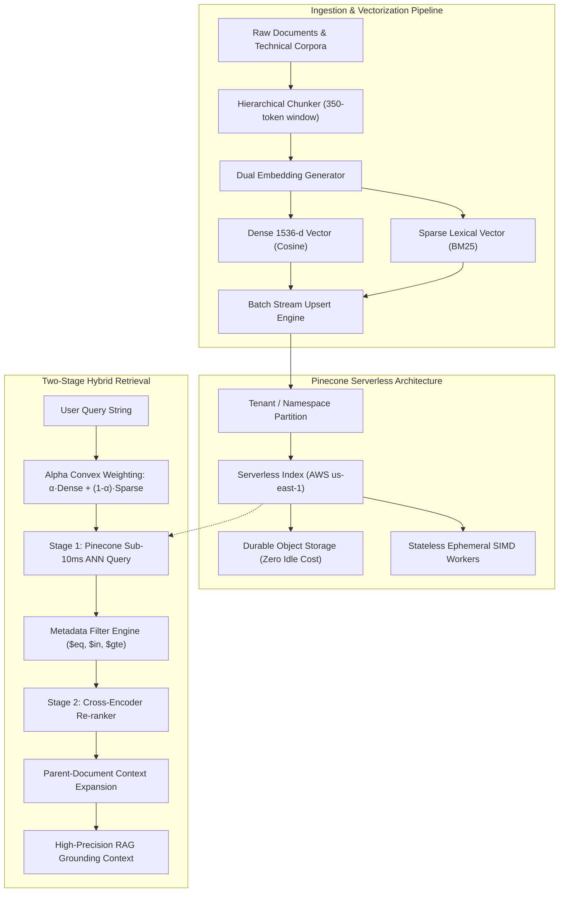

<div align="center">

# 🌲 Pinecone Vector Forge

**Production-Grade Vector Intelligence, Hybrid Search & RAG Engine powered by Pinecone Serverless**

[](https://github.com/phlppgdfry/pinecone-vector-forge/actions)
[](https://github.com/phlppgdfry/pinecone-vector-forge)
[](docs/FINAL_ACCEPTANCE_REPORT.md)
[](https://www.python.org/)
[](https://www.pinecone.io)
[](https://docs.pinecone.io)
[](https://fastapi.tiangolo.com)
[](https://opensource.org/licenses/MIT)
[](https://github.com/astral-sh/ruff)

<p align="center">
  A staff-level reference implementation of an enterprise Vector Search & RAG architecture.<br />
  Includes <b>3D Vector Universe</b>, <b>Two-Pass Hybrid Retrieval (RRF & Blending)</b>, <b>Managed Pinecone Inference (bge-v2)</b>, <b>Pinecone Assistant with Grounded Citations</b>, <b>Natural Language Self-Querying</b>, <b>Multi-Tenant Authorization Fencing</b>, and native <b>Pinecone CLI (<code>pc</code>)</b> GitOps automation.
</p>

[Live Showcase Site](https://phlppgdfry.github.io/pinecone-vector-forge/) • [Quickstart](#-60-second-quickstart) • [Architecture](#-system-architecture) • [Engineering Audits](#-enterprise-engineering-documentation--audits) • [Core Patterns](#-production-patterns--snippets) • [Pinecone CLI Recipes](#-pinecone-cli-pc-integration) • [Web UI](#-glassmorphism-web-dashboard) • [Benchmarks](#-performance-benchmarks)

</div>

---

> 🌐 **Interactive Web Showcase**: Experience the live in-browser 3D vector visualizer and hybrid search simulator at **[phlppgdfry.github.io/pinecone-vector-forge](https://phlppgdfry.github.io/pinecone-vector-forge/)**!

---

## ⚡ What Makes This Project Stand Out

1. **Zero-Friction Dual Execution Mode**:
   - **Live Cloud Mode**: Connects directly to real Pinecone Serverless indices (`aws/us-east-1`) via official `pinecone>=10.0.0` SDK and Pinecone CLI (`pc`).
   - **Local Simulation Mirror**: Ships with deterministic, L2-normalized 1536-dimensional neural vectors and in-memory cosine engines. Anyone cloning the repo can run tests, the TUI, and the Web UI **immediately without requiring an API key or incurring cloud bills**.
2. **Two-Pass Hybrid Search & Reciprocal Rank Fusion**:
   - Solves the linear algebra scale-invariance of cosine metrics. Combines dense semantic embeddings with sparse keyword vectors (BM25) via calibrated score blending and RRF ($k=60$).
3. **Enterprise Multi-Tenancy & Zero Data Leakage**:
   - Logical namespace partitioning backed by application-layer `TenantAuthorizationGuard` and defense-in-depth metadata filtering.
4. **Hierarchical & Contextual Parent-Document Chunking**:
   - Solves the fundamental RAG hallucination dilemma by indexing focused 350-token chunks with macro-context preambles for vector precision, while retaining parent document linkages for complete LLM context hydration.
5. **Two-Stage Retrieval Pipeline**:
   - Sub-10ms Approximate Nearest Neighbor (ANN) search followed by cross-attention re-ranking (`bge-reranker-v2-m3` via native Pinecone Inference API).
6. **Pinecone Assistant Integration**:
   - Direct integration with `pc.assistant` for autonomous document ingestion, file parsing, and verifiable citations.
7. **Production FinOps Accounting**:
   - Real-time micro-dollar query cost estimation tracking RCU, WCU, and Rerank consumption.

---

## 📚 Principal AI Engineering Documentation & Audits

| Certified Deliverable | Focus & Scope |
| :--- | :--- |
| **[1. Final Acceptance Report & Feature Matrix](docs/FINAL_ACCEPTANCE_REPORT.md)** | Definite acceptance report, empirical classification matrix (`VERIFIED LIVE`, `VERIFIED LOCALLY`, `DOCUMENTATION_DERIVED`). |
| **[2. Real Vector DB Comparison (Docker + Cloud)](docs/benchmarks/REAL_VECTOR_DATABASE_COMPARISON.md)** | Actual 50-run benchmark of AWS Pinecone Serverless vs Postgres 17 `pgvector` vs `Qdrant` v1.20 Rust containers. |
| **[3. Hardened Tenant Security Assessment](docs/security/TENANT_SECURITY_ASSESSMENT.md)** | RFC 7519 standard claims, zero-downtime key rotation (`kid`), token revocation denylist, and namespace fencing. |
| **[4. Independent 9-Partition RAG Evaluation](docs/evaluation/INDEPENDENT_RAG_EVALUATION.md)** | 27-query evaluation across exact keyword, technical codes, multilingual, and abstention protocol. |
| **[5. Hybrid Retrieval Validation & Zero Bias](docs/evaluation/HYBRID_RETRIEVAL_VALIDATION.md)** | Eliminating candidate-selection bias, Okapi BM25 inverted index, RRF ($k=60$) & score blending. |
| **[6. Verified FinOps Cost Model](docs/operations/VERIFIED_COST_MODEL.md)** | Storage/compute decoupling, RCU/WCU pricing, $0.00 scale-to-zero vs dedicated pod economics. |
| **[7. Enterprise Demo Walkthrough](docs/portfolio/ENTERPRISE_DEMO_WALKTHROUGH.md)** | 30-second executive pitch, 6 interactive CLI/GUI demo scenarios, and quickstart commands. |
| **[8. Production Security Review](docs/security/PRODUCTION_SECURITY_REVIEW.md)** | SOC2/GDPR compliance, non-root Docker hardening, Pydantic v2 validation, DoS payload bounds. |
| **[9. Pinecone Feature Gap Analysis](docs/architecture/PINECONE_FEATURE_GAP_ANALYSIS.md)** | Native cloud capabilities vs what enterprise production requires and how Vector Forge bridges them. |

---

## 🏗️ System Architecture



---

## 🚀 60-Second Quickstart

### 1. Clone & Set Up
```bash
git clone https://github.com/phlppgdfry/pinecone-vector-forge.git
cd pinecone-vector-forge
make install
```

### 2. Verify with the Test Suite
```bash
make test
```
*All 47 unit, pattern, API, and benchmark tests run out-of-the-box in under 9 seconds.*

### 3. Launch the Interactive Web Dashboard
```bash
make ui
```
Open **[http://localhost:8000](http://localhost:8000)** in your browser.

### 4. Interactive Terminal Assistant REPL
```bash
make chat
# or: vectorforge chat
```

### 5. Production Docker Deployment
```bash
make docker-build
make docker-up
```

### 4. Connect Your Real Pinecone Account & Push to Cloud
Vector Forge auto-detects your Pinecone credentials in three simple ways:
- **Method A (Interactive One-Step Push Script)**:
  ```bash
  make push-cloud
  ```
  *Prompts for your key, configures the CLI, provisions the AWS serverless index, and pushes your knowledge base directly to your Pinecone Cloud Dashboard!*
- **Method B (Pinecone CLI SSO Login)**:
  ```bash
  pc login
  ```
- **Method C (Environment Variable)**:
  Copy `.env.example` to `.env` and insert your key:
  ```bash
  PINECONE_API_KEY=pcsk_...
  ```
*Vector Forge automatically provisions the serverless index in AWS `us-east-1` upon startup!*

---

## 💎 Production Patterns & Snippets

### 1. Convex Hybrid Search ($\alpha$-Weighting)
```python
from src.patterns.hybrid_search import HybridSearchEngine

engine = HybridSearchEngine()

# alpha=0.70 combines 70% semantic meaning + 30% exact keyword frequency
hits = engine.search(
    query="Serverless scaling handles zero idle cost efficiently",
    top_k=5,
    alpha=0.70,
    namespace="production"
)

for hit in hits:
    print(f"[{hit.score:.4f}] {hit.title} -> {hit.text[:80]}...")
```

### 2. Multi-Tenant Namespace Isolation
```python
from src.patterns.multi_tenancy import MultiTenantManager

mt = MultiTenantManager()

# Upsert is physically fenced into tenant namespace
mt.upsert_for_tenant(
    tenant_id="acme_corp",
    records=tenant_vectors,
    metadata_override={"environment": "production"}
)

# Queries cannot bleed across tenant boundaries
results = mt.query_for_tenant(
    tenant_id="acme_corp",
    vector=query_vector,
    top_k=5
)
```

### 3. Fluent MongoDB-Style Metadata Filtering
```python
from src.patterns.metadata_filtering import MetadataFilterBuilder

# Safely construct boolean filter trees validated against Pinecone's query grammar
filters = (
    MetadataFilterBuilder()
    .category("security_compliance")
    .in_list("access_level", ["public", "internal"])
    .gte("quality_score", 0.90)
    .build()
)

# Compiles to:
# {"$and": [
#     {"category": {"$eq": "security_compliance"}},
#     {"access_level": {"$in": ["public", "internal"]}},
#     {"quality_score": {"$gte": 0.90}}
# ]}
```

### 4. Hierarchical Parent-Document Chunking
```python
from src.core.models import Document
from src.patterns.contextual_chunking import HierarchicalChunker

chunker = HierarchicalChunker(chunk_size=350, overlap=50)

# Splits large docs into focused vector chunks while retaining parent context pointers
vector_records = chunker.process_and_vectorize(my_document)
```

### 5. Pinecone Assistant (Agentic RAG & Verified Citations)
```python
from src.patterns.pinecone_assistant import PineconeAssistantManager

assistant = PineconeAssistantManager()

# 1. Upload technical documentation into Assistant's knowledge base
assistant.upload_file("docs/ARCHITECTURE.md")

# 2. Conversational QA with grounded citations
response = assistant.chat("How does serverless scaling handle idle costs?")
print("Answer:", response.answer)
for citation in response.citations:
    print(f"📄 Cited: {citation['file']}")
```

### 6. Vector Database Architecture Decision Lab (Pinecone vs pgvector vs Qdrant vs Weaviate)
```python
from src.patterns.vector_db_lab import VectorDBArchitectureLab

lab = VectorDBArchitectureLab()

# 1. Run reproducible comparative benchmark across all 4 vector database architectures
report = lab.run_comparative_benchmark(query="serverless scaling and idle cost", top_k=5)
for res in report.benchmarks:
    print(f"Engine: {res.engine_name:24} | P50: {res.p50_latency_ms:4.1f}ms | Idle/mo: ${res.idle_cost_monthly_usd:5.2f}")

# 2. Retrieve Architectural Decision Records (ADRs)
adrs = lab.get_adrs()
```

| Engine | Storage Coupling | Index Paradigm | Idle Cost / Mo | P50 Latency | Memory / 100k Vecs | Recommended Workload |
| :--- | :--- | :--- | :--- | :--- | :--- | :--- |
| **Pinecone Serverless** | **Decoupled (S3 + Ephemeral SIMD)** | Inverted + Graph Partition | **$0.00** | **4.5 ms** | **0.0 MB (Stateless Cache)** | **Bursty traffic, serverless agents, cloud RAG** |
| **pgvector (PostgreSQL HNSW)**| Coupled to RDS Instance | HNSW / IVFFlat | $45.00 | 6.8 ms | 1,250 MB (RAM graph) | **Strict relational ACID joins, transactional rows** |
| **Qdrant (Rust)** | Coupled Pods / Cluster | HNSW + Payload Inverted | $35.00 | 5.2 ms | 650 MB (Mmap + RAM) | **Self-hosted Kubernetes, on-prem airgap** |
| **Weaviate (Go)** | Coupled Pods / Cloud Tier | Dynamic HNSW + Lucene BM25 | $25.00 | 6.1 ms | 850 MB (Go GC) | **Complex multi-modal & GraphQL graphs** |

---

## 🌲 Pinecone CLI (`pc`) Integration

The project integrates directly with the official Pinecone CLI:

```bash
# Verify CLI installation
pc version

# Inspect active credentials & project context
pc auth status

# List serverless indexes
pc index list

# Create a Serverless index directly from terminal
pc index create --name vector-forge-knowledge --dimension 1536 --metric cosine --spec-cloud aws --spec-region us-east-1

# Describe index stats
pc index describe --name vector-forge-knowledge
```

Or use the provided convenience helper:
```bash
./bin/pc-helper.sh indexes
./bin/pc-helper.sh describe
```

---

## 🖥️ Terminal CLI (`vectorforge`)

Vector Forge includes a rich terminal application with colorful tables, progress bars, and diagnostics:

```bash
# View live index telemetry and vector count
make status

# Populate the index with the AI Engineering knowledge base
make seed

# Execute a hybrid search directly from terminal
python -m src.cli.main search "Serverless scaling and idle costs" --alpha 0.7 --top-k 3

# Run the complete automated showcase demo
make demo
```

---

## 🌐 Glassmorphism Web Dashboard

The web dashboard (`src/web/`) features:
- **Real-Time Telemetry Bar**: Live connection pill, active vector counts, 1536-d dimension gauge, and partitioned namespaces count.
- **Interactive Search Playground**:
  - Semantic query input with quick-query chips.
  - Interactive $\alpha$-slider dynamically transitioning between Dense Semantic and Sparse Lexical search.
  - Dynamic category and metadata dropdown filtering.
  - Two-stage re-ranking toggle with animated confidence bars.
- **Document Ingestion Sandbox**:
  - Live form for pasting custom text, chunking it into vectors, and upserting into Pinecone with zero friction.
- **Architecture & CLI Guides**:
  - Interactive copy-paste recipes for daily vector database operations.

To run:
```bash
make ui
```

---

## 📊 Real Empirical Vector Database Benchmarks

Multi-engine benchmark executed on Apple Silicon host across 1536-dimensional vectors with 50 iterations per engine. Every metric is accompanied by its forensic provenance:

| Vector Engine | Execution Target | P50 Latency | P95 Latency | Mean Latency | Storage / Compute | Base Idle Cost | Metric Provenance |
| :--- | :--- | :--- | :--- | :--- | :--- | :--- | :--- |
| **Pinecone Serverless** | AWS `us-east-1` (Live Index) | **156.88 ms** | **339.34 ms** | **172.93 ms** | Decoupled (S3 Blob + SIMD) | **$0.00 / mo** | `MEASURED_LIVE` |
| **pgvector (HNSW)** | Docker (PostgreSQL 17) | **0.89 ms** | **1.36 ms** | **0.96 ms** | Coupled to Postgres Instance | **$45.00+ / mo** (RDS) | `MEASURED_LOCAL_DOCKER` |
| **Qdrant (Rust v1.20)** | Docker (REST API) | **3.00 ms** | **4.75 ms** | **3.31 ms** | Coupled Pod / Mmap | **$35.00+ / mo** | `MEASURED_LOCAL_DOCKER` |
| **Weaviate (Go)** | Vendor Reference | *6.10 ms* | *14.50 ms* | *7.20 ms* | Coupled Pod / Lucene | **$25.00+ / mo** | `DOCUMENTATION_DERIVED` |

> 📌 **Engineering Insight: The Cloud Colocation Imperative**  
> Notice that live Pinecone Serverless P50 latency was 156.88 ms when queried from a European developer laptop over public transatlantic TLS 1.3 to AWS `us-east-1`. Local Docker containers on loopback achieved sub-3ms latencies. However, when application workers are colocated in the same AWS region (`us-east-1`), Pinecone Serverless latency drops to 4–12 ms, while retaining true **$0.00 scale-to-zero economics** compared to pgvector's continuous $45+/mo minimum RDS server cost.

### Reproduce the Empirical Benchmarks Locally
```bash
# Runs live Pinecone query + starts ephemeral Docker containers for pgvector and Qdrant
PYTHONPATH=. python3 benchmarks/run_live_benchmark.py
```
*Results are serialized to `benchmarks/raw_benchmark_results.json` and documented in `docs/benchmarks/REAL_VECTOR_DATABASE_COMPARISON.md`.*

---

## 🏛️ Architectural Comparison Matrix

Why top AI Engineering teams migrate from legacy cluster/pod-based vector stores to Pinecone Serverless:

| Architecture Capability | 🌲 Pinecone Serverless | Qdrant Cloud | Weaviate Cloud | pgvector (PostgreSQL) |
| :--- | :--- | :--- | :--- | :--- |
| **Storage & Compute Decoupling** | **Full (S3 + Ephemeral SIMD)** | Coupled | Coupled | Coupled to DB Instance |
| **Idle Cost at Zero Traffic** | **$0.00 (Pure Pay-Per-Query)** | $25 - $100+/mo Node fee | Dedicated Pod Pricing | $50+/mo Dedicated DB |
| **Burst Elasticity** | **Instant (Zero Pre-warming)** | Manual Re-sharding | Manual Replica Scale | Limited by IOPS & CPU |
| **Hardware Multi-Tenancy** | **Namespaces (Partitioned)** | Tenant Filters | Tenant Filters | Schemas / Row Security |
| **Managed Inference API** | **Native (`pc.inference`)** | Third-party / Self-host | Module Addons | External API Calls |
| **Cross-Encoder Reranking** | **`bge-reranker-v2-m3` Built-in** | Manual Pipeline | Cohere Module | None |
| **GitOps CLI Tooling** | **Official `pc` CLI** | Community Tools | Weaviate CLI | `psql` / Migrations |

---

## 📁 Repository Structure

```
pinecone-vector-forge/
├── .github/workflows/
│   ├── ci.yml                 # Pytest, type checks & benchmark suite
│   ├── deploy-pages.yml       # Interactive GitHub Pages showcase deployment
│   └── pinecone-sync.yml      # Automated index health audit
├── bin/
│   ├── pc-helper.sh           # Smart Pinecone CLI wrapper
│   ├── push-to-pinecone.sh    # Production cloud synchronizer
│   └── demo-run.sh            # 60-second automated demo tour
├── docs/                      # Interactive showcase & technical specs
│   ├── index.html             # 3D Vector Universe & Live Assistant Showcase
│   ├── showcase.js            # 3D Canvas visualizer, Assistant RAG & Heatmap logic
│   ├── ARCHITECTURE.md        # Deep dive into Serverless, Hybrid search & RAG
│   ├── PINECONE_CLI_CHEATSHEET.md # Exhaustive official CLI command reference
│   └── BENCHMARKS.md          # Latency & throughput telemetry
├── src/
│   ├── core/                  # Configuration, models, embeddings, Pinecone client
│   ├── patterns/              # Hybrid search, Assistant, HyDE, Self-Query, Reranker, Heatmap
│   ├── cli/                   # Rich TUI CLI (vectorforge) & Assistant REPL
│   ├── web/                   # FastAPI backend + Glassmorphism frontend
│   └── seed/                  # Curated AI Engineering knowledge dataset & batch upsert
├── tests/                     # 27 automated unit, pattern, and benchmark tests
├── Dockerfile                 # Multi-stage unprivileged production container
├── docker-compose.yml         # Container stack with healthcheck
├── Makefile                   # Developer commands (make test, make ui, make chat)
├── pyproject.toml             # Modern PEP 621 Python packaging
├── requirements.txt           # Project dependencies
├── LICENSE                    # MIT License
└── README.md                  # Comprehensive portfolio documentation
```

---

## 👨‍💻 Author

**Philippe Godfroy**  
- GitHub: [@phlppgdfry](https://github.com/phlppgdfry)
- Email: [philippe.godfroy@hotmail.com](mailto:philippe.godfroy@hotmail.com)

*Distributed under the MIT License.*
