# Pinecone Platform Feature Gap Analysis & Enterprise Solutions Architecture

> **Document ID:** ARCH-GAP-PINECONE-2026  
> **Target Cloud:** Pinecone Serverless (AWS `us-east-1`)  
> **Author:** Enterprise AI Solutions Architect & Vector Database Architect  
> **Status:** Production Architecture Assessment

---

## 1. Executive Summary

Pinecone Serverless is an industry-leading vector search engine that excels at decoupled cloud-native storage, sub-10ms approximate nearest neighbor (ANN) retrieval, and zero-idle cost scaling. However, building an enterprise-grade AI production application on Pinecone requires understanding what Pinecone provides natively versus what must be engineered at the application layer.

This document presents a rigorous **Capability Gap Analysis** detailing how *Pinecone Vector Forge* bridges these gaps.

---

## 2. Feature Capability & Responsibility Matrix

```mermaid
flowchart LR
    subgraph NativeCloud["Native Pinecone Platform"]
        P1["Decoupled S3 Vector Storage"]
        P2["Stateless SIMD Query Workers"]
        P3["Inverted Metadata Filtering ($in, $eq)"]
        P4["Logical Namespaces"]
        P5["Inference Rerank API (BGE / Cohere)"]
        P6["Pinecone Assistant (Managed RAG)"]
        P7["Pinecone CLI ('pc')"]
    end
    
    subgraph ForgeEngine["Pinecone Vector Forge Layer"]
        F1["Independent Okapi BM25 Inverted Index"]
        F2["Reciprocal Rank Fusion (Zero-Bias)"]
        F3["HMAC-SHA256 Cryptographic Tenant Fencing"]
        F4["Self-Query Natural Language Deconstructor"]
        F5["HyDE Hypothetical Passage Engine"]
        F6["Hallucination & Citation Abstention Guard"]
        F7["Semantic Cache & FinOps Unit Economics"]
    end
    
    NativeCloud -->|Incorporate| ForgeEngine
    ForgeEngine --> App["Enterprise Production RAG Application"]
```

| Architectural Requirement | Pinecone Serverless Native Capability | Architectural Limitation / Gap | Pinecone Vector Forge Solution |
| :--- | :--- | :--- | :--- |
| **Dense ANN Search** | Native cosine, dotproduct, euclidean index | Requires pre-vectorized floats or inference model | `get_embedding_generator()` provides seamless bi-encoder batch vectorization. |
| **Sparse Lexical Search** | Supports sparse vector upserts (`indices`, `values`) | No native inverted index across arbitrary raw text payloads | Implemented `NamespaceInvertedIndex` with Okapi BM25 and RSJ-IDF postings. |
| **Candidate-Selection Bias** | Pure dense search only scores dense nearest neighbors | Omits rare error codes / SKUs from candidate pool | **Two-pass retrieval:** Dense ANN + Inverted BM25 queried independently and fused via RRF ($k=60$). |
| **Multi-Tenant Security** | Namespaces provide logical partitioning inside index | **Zero cryptographic enforcement**: Any client passing `namespace="x"` can access it if API key is shared | `HMACSecuritySigner` enforces signed tokens (`vf1...`) with tenant scoping before any query touches Pinecone. |
| **Metadata Filtering** | Native operators: `$eq`, `$in`, `$gt`, etc. | Queries must be structured JSON, not natural language | `SelfQueryDeconstructor` parses natural language ("critical runbooks from Philippe") into structured filters. |
| **Query Expansion** | Query vector represents raw input terms | Short or ambiguous queries lack semantic density | `HyDESearchEngine` generates hypothetical passages to align query vector with answer manifold. |
| **Two-Stage Reranking** | Native inference rerank endpoint (`bge-reranker-v2-m3`) | Requires network roundtrip and per-call fee | `TwoStageReranker` balances managed inference with local cross-encoder fallback. |
| **Managed Agent RAG** | Pinecone Assistant API with document parsing | Opaque generation prompt; limited fine-grained chunk inspection | `PineconeAssistantManager` exposes dual-mode: managed Assistant for ease, custom pipeline for deep auditability. |
| **Cost & FinOps Tracking** | Monthly cloud invoice billing | No per-query real-time cost telemetry | `FinOpsCostModel` computes instantaneous RCU and storage dollar fractions per request. |
| **Offline / Air-Gap Support**| Cloud-only (AWS, GCP, Azure) | Cannot run on sovereign disconnected infrastructure | `VectorDBArchitectureLab` documents pgvector and Qdrant transition paths for air-gapped deployments. |

---

## 3. Detailed Gap Remediation Case Studies

### Case Study A: The Multi-Tenant API Key Dilemma
* **The Problem:** In a multi-tenant B2B application, distributing the master `PINECONE_API_KEY` to frontend clients or microservices allows any caller to query any namespace or delete the entire index.
* **The Vector Forge Solution:** The Pinecone API key is retained exclusively on the backend gateway. The gateway exposes a micro-auth service issuing signed HMAC-SHA256 bearer tokens scoped to individual tenant IDs and permissions (`read`, `write`).

### Case Study B: The Lexical Precision Void
* **The Problem:** Dense embeddings model semantic meaning, meaning `ERR_PG_REPL_LAG_902` and `ERR_PG_REPL_LAG_903` have an embedding similarity of >0.98, leading to false positives, while exact keyword lookups fail if vocabulary is rare.
* **The Vector Forge Solution:** An independent inverted index running Okapi BM25 runs in parallel. If an exact identifier appears in query terms, BM25 assigns a maximal score, ensuring correct retrieval regardless of dense semantic clustering.

---

## 4. Architectural Summary

Pinecone Serverless provides a world-class vector indexing substrate. *Pinecone Vector Forge* serves as the enterprise production wrapper that supplies security, hybrid precision, governance, and cost intelligence.
