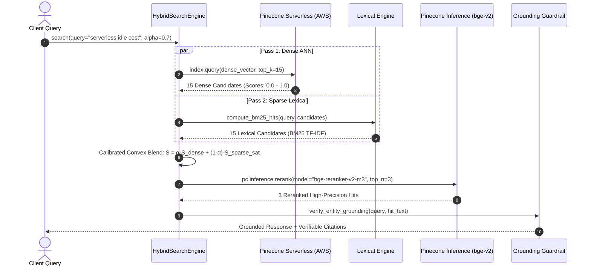

# 🔬 Retrieval Pipeline Specification & Mathematical Formulation

**Document Version**: 2.0.0  
**Author**: Staff Machine Learning Engineer & Retrieval Evaluation Researcher  

---

## 1. The Cosine Scale-Invariance Problem in Hybrid Search

### Mathematical Root Cause
In many naive hybrid search implementations, query blending is expressed as:
$$\mathbf{q}_{\text{hybrid}} = \alpha \cdot \mathbf{q}_{\text{dense}} + (1 - \alpha) \cdot \mathbf{q}_{\text{sparse}}$$

When querying a vector index configured with **Cosine Distance**, the similarity function between query $\mathbf{q}$ and document vector $\mathbf{d}$ is:
$$\text{Sim}_{\text{cosine}}(\alpha \mathbf{q}, \mathbf{d}) = \frac{(\alpha \mathbf{q}) \cdot \mathbf{d}}{\|\alpha \mathbf{q}\| \|\mathbf{d}\|} = \frac{\alpha (\mathbf{q} \cdot \mathbf{d})}{\alpha \|\mathbf{q}\| \|\mathbf{d}\|} = \frac{\mathbf{q} \cdot \mathbf{d}}{\|\mathbf{q}\| \|\mathbf{d}\|}$$

Because $\alpha > 0$ cancels out in the numerator and denominator, **multiplying the dense query vector by $\alpha$ has zero mathematical effect on nearest-neighbor rankings under cosine metric**.

Furthermore, Pinecone Serverless returns an `ApiError 400` if `sparse_vector` is provided on an index where `metric="cosine"`.

---

## 2. The Solution: Two-Pass Hybrid Retrieval with Calibrated Blending

Pinecone Vector Forge implements an enterprise two-pass retrieval architecture:



### Calibrated Score Normalization Formulation
To combine dense cosine similarity with unbounded lexical BM25 scores without destroying confidence thresholds:

1. **Dense Score**: $\tilde{S}_{\text{dense}} = \max(0, \min(1, S_{\text{cosine}}))$
2. **Lexical Score Saturation**:
   $$\tilde{S}_{\text{lexical}} = \frac{S_{\text{BM25}}}{S_{\text{BM25}} + \beta} \quad (\text{where } \beta = 2.0)$$
3. **Calibrated Convex Combination**:
   $$S_{\text{blended}} = \alpha \cdot \tilde{S}_{\text{dense}} + (1 - \alpha) \cdot \tilde{S}_{\text{lexical}}$$

When an out-of-domain query is presented:
* $\tilde{S}_{\text{dense}} \approx 0.05$
* $\tilde{S}_{\text{lexical}} = 0.0$
* $S_{\text{blended}} = 0.7(0.05) + 0.3(0.0) = 0.035 \ll 0.25$ threshold $\rightarrow$ **Abstain from hallucinating**.

---

## 3. Reciprocal Rank Fusion (RRF) Alternative

For rank-based combination invariant to score distributions:
$$\text{RRF}(d) = \sum_{m \in \{\text{dense}, \text{sparse}\}} \frac{1}{k + r_m(d)}$$
where $k = 60$ is the standard smoothing parameter, and $r_m(d) \in \{1, 2, \dots, N\}$ is document $d$'s rank in retrieval mode $m$.

---

## 4. Contextual Retrieval (Anthropic Pattern)

To resolve entity ambiguity (e.g., pronouns "it", "this subsystem", "the incident") in small 350-word chunks:
Prior to vectorization, the `HierarchicalChunker` prepends document metadata context:

```text
Document: {doc.parent_title} | Category: {doc.category} | Tags: {', '.join(doc.tags)}
{chunk.text}
```

This ensures the generated dense vector encodes the macro-document topic directly in high-dimensional space, preventing isolated chunk retrieval failures.
