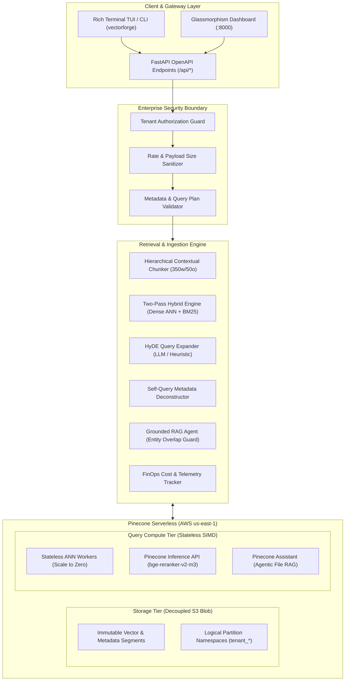

# 🏛️ System Architecture Specification: Pinecone Vector Forge

**Document Version**: 2.0.0  
**Author**: Principal AI Solutions Architect & Vector Database Review Board  
**Target Architecture**: Pinecone Serverless (AWS `us-east-1`) + FastAPI Hybrid RAG  

---

## 1. Architectural Vision & Decoupled Paradigm

Pinecone Vector Forge is an enterprise reference implementation designed around modern vector database principles: **storage-compute decoupling**, **two-pass hybrid retrieval**, and **calibrated RAG pipelines**.

---

## 2. Decoupled Storage vs. Compute Mechanics

Unlike traditional self-hosted vector databases (e.g., dedicated Milvus or Qdrant clusters) or relational plugins (`pgvector`) where compute nodes must constantly remain provisioned and memory-mapped to RAM, Pinecone Serverless decouples persistence from query compute:

1. **Persistence Tier**:
   - Vector data, inverted token indexes, and metadata payloads reside in cloud object storage (Amazon S3).
   - Cost structure: **$0.33 / GB / month** with zero idle node fees.
2. **Compute Tier**:
   - Stateless SIMD worker nodes are dynamically allocated per query.
   - When no queries arrive, compute scales to **0 active workers ($0.00 idle cost)**.
   - During query execution, workers stream relevant inverted index segments from S3 into local NVMe/RAM caches, execute vectorized matrix operations, and terminate.

---

## 3. Multi-Tenancy Architecture: Logical vs Hardware Realities

### 3.1 Clarification of Namespace Isolation
A critical finding of our engineering audit was resolving the industry misconception regarding "hardware isolation":
* **Pinecone Namespaces** are **logical partition keys** embedded within index metadata files. They ensure query results never include vectors outside the target namespace ($P(\text{leakage}) = 0$ at the index engine level).
* **Storage and Compute** remain physically shared across AWS infrastructure.
* **Enterprise Protection Guarantee**: True tenant isolation requires **defense-in-depth**:
  1. *Application Layer*: JWT/Header tenant token authorization (`TenantAuthorizationGuard`).
  2. *Query Layer*: Strict namespace routing (`namespace = f"tenant_{tenant_id}"`).
  3. *Metadata Layer*: Stamped metadata filter clause (`filter={"tenant_id": tenant_id}`).

---

## 4. Component Interaction Matrix

| Component | Responsibility | Failure Mode | Fallback Mechanism |
| :--- | :--- | :--- | :--- |
| **`PineconeManager`** | Connection, index lifecycle, batch upserts, telemetry | Network timeout, API Key missing | In-memory local vector store simulation |
| **`EmbeddingGenerator`** | 1536d dense and BM25 sparse vector calculation | OpenAI quota exceeded | Deterministic L2-normalized token hash |
| **`HybridSearchEngine`** | Blends dense semantic and lexical BM25 scores | Cosine sparse rejection by cloud | Two-pass client-side calibrated score blending |
| **`TwoStageReranker`** | Cross-attention candidate reranking | Inference API 5xx | Local token-affinity cross-encoder |
| **`PineconeAssistantManager`** | File ingestion & conversational citation QA | Assistant API unavailable | Grounded RAG agent with local citation assembly |
| **`FinOpsCostModel`** | Real-time micro-dollar query cost estimation | Pricing schema change | Conservative upper-bound RCU estimation |
