# 📡 Observability, Telemetry & SRE Playbook

**Document Version**: 2.0.0  
**Author**: DevOps & SRE Architect & MLOps Engineer  
**Standard**: OpenTelemetry & Prometheus Compatible  

---

## 1. Golden Signals & SRE Service Level Objectives (SLOs)

| Service Level Indicator (SLI) | Production Target (SLO) | Measurement Point | Alert Threshold |
| :--- | :--- | :--- | :--- |
| **Availability** | **99.95%** successful queries | Gateway `/api/search` status code < 500 | Error rate > 0.1% over 5m |
| **P50 Latency** | **< 15 ms** | End-to-end HTTP request duration | P50 > 25 ms |
| **P99 Latency** | **< 60 ms** (including Reranker) | End-to-end HTTP request duration | P99 > 120 ms |
| **Pinecone ANN Latency** | **< 10 ms** | Client `time.perf_counter` around Pinecone query | Index latency > 30 ms |
| **Reranker Latency** | **< 20 ms** | Duration of Pinecone Inference call | Inference latency > 50 ms |
| **Abstention Health** | **> 90%** on unanswerable test probes | Grounding guardrail accuracy | Abstention rate < 80% |

---

## 2. Distributed Tracing Spans (OpenTelemetry Specification)

Every search request generates a structured trace spanning the entire retrieval lifecycle:

```mermaid
gantt
    title Distributed Retrieval Trace Timeline
    dateFormat X
    axisFormat %s ms
    section Gateway
    Authentication & Tenant Check : 0, 1
    Input Validation & Schema Parse : 1, 2
    section Stage 1: Retrieval
    Embedding Generation (Dense) : 2, 4
    Lexical BM25 Candidate Tokenization : 4, 6
    Pinecone Serverless ANN Query (AWS us-east-1) : 6, 14
    section Stage 2: Reranking
    Pinecone Inference (bge-reranker-v2-m3) : 14, 24
    section Stage 3: Guardrail
    Entity Overlap & Citation Grounding : 24, 25
    Response Serialization & FinOps Accrual : 25, 26
```



---

## 3. Prometheus Metrics Schema (`/api/metrics`)

The application natively exposes OpenMetrics on `/api/metrics`:

```text
# HELP vectorforge_total_vectors Total number of indexed vectors
# TYPE vectorforge_total_vectors gauge
vectorforge_total_vectors 7

# HELP vectorforge_dimension Dimensionality of the active index
# TYPE vectorforge_dimension gauge
vectorforge_dimension 1536

# HELP vectorforge_connected Connection health to Pinecone cloud (1=connected, 0=offline)
# TYPE vectorforge_connected gauge
vectorforge_connected 1

# HELP vectorforge_estimated_cost_per_query_usd Estimated baseline RCU cost
# TYPE vectorforge_estimated_cost_per_query_usd gauge
vectorforge_estimated_cost_per_query_usd 0.0000004

# Partition vector counts by namespace
vectorforge_namespace_vectors{namespace="default"} 7
```

---

## 4. Privacy & Data Protection Safeguards

To prevent PII or secret leakage in observability pipelines:
1. **No Raw Prompt Logging**: User query strings are truncated or hashed in application logs (`query_hash = sha256(query)[:8]`).
2. **Redacted Headers**: Authorization tokens and `X-Tenant-ID` are sanitized in web server logs.
3. **No Vector Values in Traces**: Only vector IDs, scores, and document categories are surfaced in trace spans.
