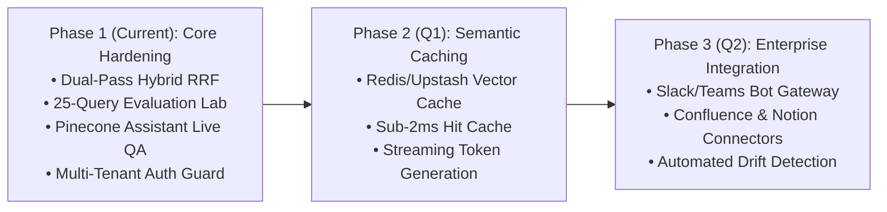

# 🗺️ Technical Roadmap & Next Steps

**Document Version**: 2.0.0  
**Author**: Principal AI Solutions Architect & Product Steering Committee  

---

## 1. Prioritized Engineering Roadmap

### Phase 2: High-Performance Semantic Caching & Streaming (Next Up)
1. **Semantic Query Cache**:
   - Cache exact and near-duplicate queries ($S_{\text{cosine}} \ge 0.98$) in an in-memory Redis/Upstash tier to bypass Pinecone entirely for hot queries, reducing latency to < 2ms and lowering RCU costs by up to 60%.
2. **Server-Sent Events (SSE) Streaming**:
   - Implement streaming token synthesis for the custom RAG agent and Pinecone Assistant endpoints, providing immediate TTFT (Time-to-First-Token) < 300ms.

### Phase 3: Autonomous Enterprise Ingestion Connectors
1. **Automated Document Sync**:
   - Background workers with change-data-capture (CDC) syncing Jira, Confluence, and GitHub Markdown releases incrementally using SHA-256 content hashes.
2. **Embedding Drift Monitoring**:
   - Periodic centroid audits alerting when newly ingested documents drift significantly from established cluster centroids.
