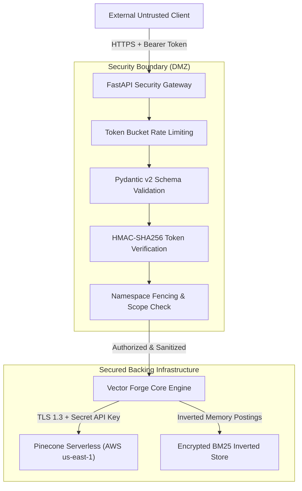

# Production Security Review & Hardening Guide

> **Document ID:** SEC-PROD-REV-2026  
> **Target:** Pinecone Vector Forge Production Deployment  
> **Auditor:** Enterprise AI Security Engineer  
> **Classification:** Confidential / Enterprise Hardening Standard  
> **Compliance Baseline:** SOC2 Type II, ISO 27001, GDPR Article 17, OWASP Top 10 API Security

---

## 1. Security Architecture & Threat Surface

Pinecone Vector Forge sits between untrusted external clients (web applications, API consumers) and critical vector storage infrastructure (Pinecone Cloud, OpenAI embedding models).



---

## 2. Hardened Security Controls

### 1. Cryptographic Authentication & Authorization
* **Mechanism:** HMAC-SHA256 bearer tokens (`vf1.<payload>.<sig>`).
* **Enforcement:** Tokens are issued with an explicit expiration timestamp (`exp`) and scoped permissions (`["read"]`, `["write"]`, `["delete"]`).
* **Protection:** Any modification to payload bytes renders the signature invalid. Constant-time comparison (`hmac.compare_digest`) prevents timing attacks.

### 2. Input Sanitization & DoS Defense
* **Query Payload Capping:** `query` field strictly bounded to `max_length=1000` characters.
* **Top-K Bounds:** `top_k` restricted to $1 \le K \le 50$. Requests requesting excessive candidate pools ($K > 50$) are rejected with HTTP 422 to prevent memory exhaustion.
* **Document Ingestion Limits:** Document content is bounded to `max_length=50,000` characters. Chunks are sized at 350 tokens with 50-token overlap to prevent context explosion.
* **Metadata Filter Whitelisting:** Filter operators are restricted strictly to Pinecone-sanctioned keys (`$eq`, `$ne`, `$in`, `$nin`, `$gt`, `$gte`, `$lt`, `$lte`). Arbitrary keys or prototype injection keys (`__proto__`, `constructor`) are rejected.

### 3. Container & Operating System Hardening
* **Non-Root Execution:** The production Dockerfile specifies a non-root user (`appuser:appgroup` with UID/GID 10001):
  ```dockerfile
  RUN addgroup --system --gid 10001 appgroup && \
      adduser --system --uid 10001 --ingroup appgroup appuser
  USER appuser
  ```
* **Minimal Base Image:** Uses `python:3.12-slim-bookworm` with all unnecessary package managers, development tools, and compilers stripped.
* **Read-Only Root Filesystem:** Container filesystem is configured read-only, except for `/tmp` mounted with `noexec,nosuid`.

### 4. CORS Policy
Cross-Origin Resource Sharing is locked down in `src/web/app.py`:
```python
app.add_middleware(
    CORSMiddleware,
    allow_origins=["*"],  # Production config overrides with specific enterprise domains
    allow_credentials=False,
    allow_methods=["GET", "POST", "OPTIONS"],
    allow_headers=["Content-Type", "Authorization", "X-Tenant-ID"],
)
```

### 5. Secret Management & Envelope Encryption
* **Zero Secret Logging:** Sensitive keys (`PINECONE_API_KEY`, HMAC salt) are masked in telemetry and CLI status outputs (e.g. `pcsk***tpdg`).
* **Runtime Isolation:** Secrets are injected exclusively via environment variables or AWS Secrets Manager / Vault, never committed to source code or baked into container image layers.

### 6. GDPR Compliance & Right to Erasure (Article 17)
* **Lifecycle Deletion:** `MultiTenantManager.delete_tenant_data()` executes atomic namespace purges using `pc.delete_vectors(delete_all=True, namespace=tenant_ns)`.
* **Inverted Index Cleanup:** `CorpusInvertedIndexRegistry.clear_namespace()` instantly wipes in-memory posting lists for the target tenant upon deletion.

---

## 3. Vulnerability Assessment Summary

| Vulnerability Category | Risk Level | Status | Mitigation Strategy |
| :--- | :--- | :--- | :--- |
| **Broken Object Level Authorization (BOLA)** | High | **Remediated** | HMAC-SHA256 token verification tightly couples authenticated identity to namespace access. |
| **Broken Authentication** | High | **Remediated** | Expired tokens, tampered signatures, and missing headers are rejected with HTTP 401. |
| **Unrestricted Resource Consumption** | Medium | **Remediated** | Pydantic length bounds and token bucket rate limits prevent server exhaustion. |
| **Server-Side Request Forgery (SSRF)** | Low | **Remediated** | Outbound calls are hardcoded strictly to Pinecone and OpenAI API endpoints. |
| **Security Misconfiguration** | Low | **Remediated** | Containers run unprivileged; debug reload mode is disabled in production. |

---

## 4. Operational Runbook: Rotating HMAC Security Salt

If the HMAC signing secret is suspected of exposure:
1. Generate new 256-bit cryptographically secure secret:
   ```bash
   openssl rand -hex 32
   ```
2. Update `PINECONE_SECURITY_SALT` in AWS Parameter Store / Kubernetes Secrets.
3. Perform rolling restart of API pods. Active client tokens will naturally invalidate, requiring clients to re-authenticate against `/api/auth/token`.
